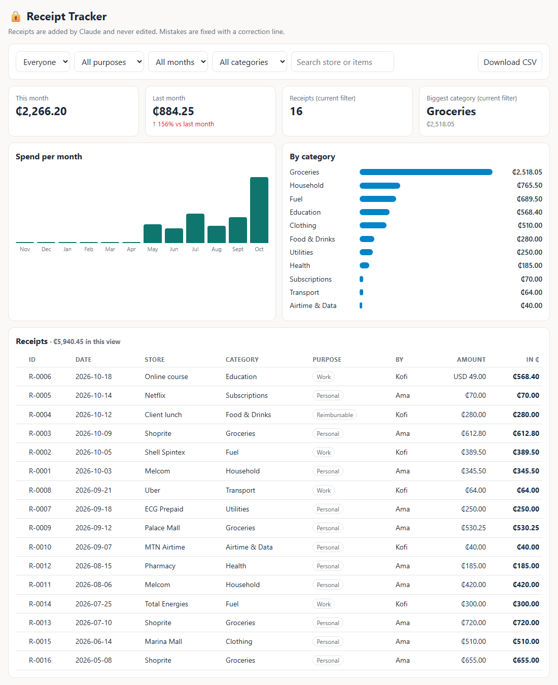

# Receipt Tracker

A free, private expense tracker that lives in a folder on **your own computer**. Drop a photo of a receipt into a Claude chat, say "log this", and it shows up on a dashboard. No accounts, no logins, no API keys, nothing uploaded anywhere.



*The dashboard, shown with made-up sample receipts.*

## What you get

- A **dashboard** (`dashboard.html`) with this month vs last month, spend per month, spend by category, and a searchable list of receipts. Each receipt links to its saved photo.
- **Personal / Work / Reimbursable** on every receipt, so you can filter an expense claim and **download it as a CSV**.
- **Locked entries.** Receipts are only ever added. A mistake is fixed by adding a *correction* line, like a bank statement, so your records stay trustworthy.
- **Any currency.** Foreign receipts are converted to your home currency using that day's free exchange rate.

## Get started (5 minutes)

1. Download this project (green **Code** button → **Download ZIP**) and unzip it somewhere you'll remember, for example your Documents folder.
2. Open that folder in [Claude Code](https://claude.com/claude-code) or Cowork (any Claude that can read and write files in a folder).
3. Drop a receipt photo, screenshot or PDF into the chat and say **"log this"**.
4. The first time, Claude asks your name and home currency. Then it shows you what it read and asks if the receipt is Personal, Work or Reimbursable.
5. Double-click **`dashboard.html`** to see your spending. Refresh the page after each new receipt.

## Your data stays yours

Your receipts are saved in two places inside *your* copy of the folder: `data.js` (the list) and `receipts/` (the photos). They are never uploaded anywhere, and they are listed in `.gitignore` so they can't be pushed to GitHub by accident. Everyone who downloads this gets their own empty copy.

## Sharing with family or a team

Each person uses their own copy. To keep one shared tracker, put the folder somewhere everyone can open (OneDrive, Dropbox, Google Drive, a shared drive) and have each person log receipts into it. Every receipt records who spent it, so you can filter by person.

## Changing your currency

Claude does this on first run, or edit `settings.js`:

```js
window.SETTINGS = { currency: "USD", symbol: "$" };
```

## Limits

- Logging happens through Claude, so you need access to Claude with file access. There is no website to upload to.
- Receipt reading is only as good as the photo. Claude always shows you what it read before saving.
- The dashboard is a plain file for a single computer or shared folder, not a multi-user website.

## How it works (for the curious)

No server. `CLAUDE.md` tells Claude how to log a receipt: read it, confirm with you, copy the original into `receipts/`, and append one line to `data.js`. `dashboard.html` reads that list in your browser and draws the charts. Exchange rates come from the free [currency-api](https://github.com/fawazahmed0/currency-api).
